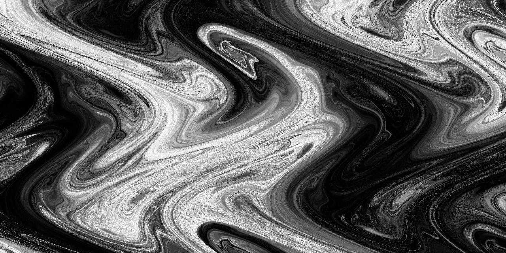

# 🎨 shader-suminagashi

Shader GLSL criado para replicar o efeito visual tradicional do **Suminagashi** (墨流し) — a arte japonesa de pintura sobre a água.

Visual minimalista em tons monocromáticos, com linhas onduladas animadas que evocam a fluidez da tinta flutuando na superfície.



## 🌐 Demonstração ao vivo

Você pode visualizar e interagir com o shader diretamente no Shadertoy:

🔗 [Visualizar shader no Shadertoy](https://www.shadertoy.com/view/tXdXWH)

Ou incorporar em uma página HTML com o seguinte snippet:

```html
<iframe width="640" height="360" frameborder="0"
  src="https://www.shadertoy.com/embed/tXdXWH?gui=true&t=10&paused=true&muted=false"
  allowfullscreen></iframe>
```

## 🧠 Como funciona

O shader aplica múltiplas distorções senoidais sobre coordenadas UV normalizadas, simulando os padrões fluidos e caóticos do Suminagashi. Os principais elementos da lógica são:

- **Distorções harmônicas:** loops com funções `cos` modificando `uv.x` e `uv.y` de forma recursiva para criar linhas onduladas.
- **Animação temporal:** uso do `iTime` para gerar movimento suave ao longo do tempo.
- **Escala de cinza:** intensidade da cor é calculada com base em `sin()` invertido, para produzir um contraste suave e orgânico.
- **Foco em estética minimalista:** nenhuma cor além do branco, preto e tons de cinza.

## 📄 Código-fonte principal

```glsl
void mainImage(out vec4 fragColor, in vec2 fragCoord) {
    vec2 uv = (2.0 * fragCoord - iResolution.xy) / min(iResolution.x, iResolution.y);
    float scaledTime = iTime / 12.0;

    float baseGray = 1.0;
    float iteration = 30.0;

    for(float i = 1.0; i < iteration; i++) {
        float freqX = 4.0;
        float freqY = 3.0;
        float amp = 0.5;

        uv.x += amp / i * cos(i * freqX * uv.y + scaledTime);
        uv.y += amp / i * cos(i * freqY * uv.x + scaledTime);
    }

    float brightness = 1.0 - abs(sin(scaledTime - uv.x - uv.y));
    fragColor = vec4(vec3(baseGray * brightness), 1.0);
}
```

## 📦 Recursos utilizados

- [Shadertoy](https://www.shadertoy.com/) — plataforma de testes e visualização de shaders GLSL.
- GLSL (OpenGL Shading Language)
- Estética inspirada em arte tradicional japonesa.

## 🚧 Melhorias futuras

- Adicionar controle de paleta de cores (versões coloridas).
- Controle interativo de parâmetros (amplitude, iterações, tempo).
- Suporte a movimento do mouse para distorção dinâmica.

## 📄 Licença

[MIT](LICENSE)
